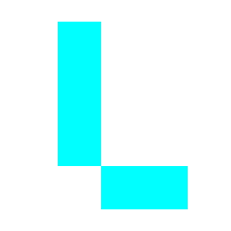

# Lumini

Lumini is a procedural, simple, and minimalist programming language designed for zero-cost high-level abstraction, memory efficiency, rapid development, and ease of use.

## Table Of Contents
- [Lumini](#lumini)
  - [Table Of Contents](#table-of-contents)
  - [Example](#example)
  - [Roadmap](#roadmap)
  - [License](#license)
    - [Branding Notice](#branding-notice)

## Example

```text
import std

fn main():
    std.print("Hello")
end
```

## Roadmap

* [ ] *1. Initial Toolchain Architecture:*
  * [x] **ISA**
  * [ ] **ABI**
  * [ ] **Formats**
  * [ ] **Utilities**
* [ ] *2. Lumini VM:*
  * [ ] **Instance**
  * [ ] **Utility**
  * [ ] **Runtime**
  * [ ] **Main**
* [ ] *3. Language:*
  * [ ] **Final Design**
  * [ ] **Standard Library**
  * [ ] **Comprehensive Mock Programs**
* [ ] *4. Lumini Compiler*
* [ ] *5. Lumini Shell*
* [ ] *6. 1st Release*

## License

This project is licensed under the [Apache 2.0 License](http://www.apache.org/licenses/LICENSE-2.0).

### Branding Notice
The design assets in this directory can be freely used and modified. However, they may not be used to represent an official or endorsed version of this language. Please see the root [`NOTICE.txt`](NOTICE.txt) file for the full asset policy.
